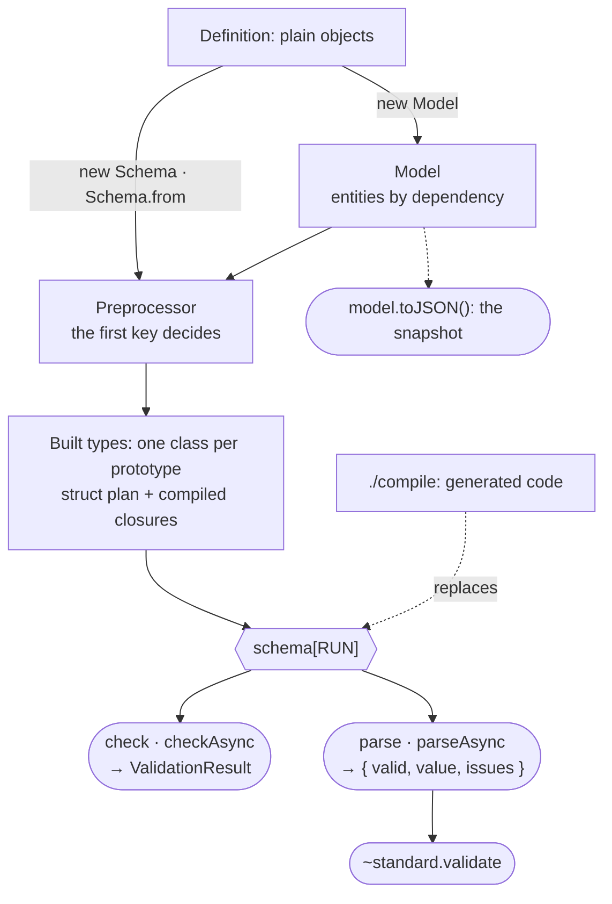
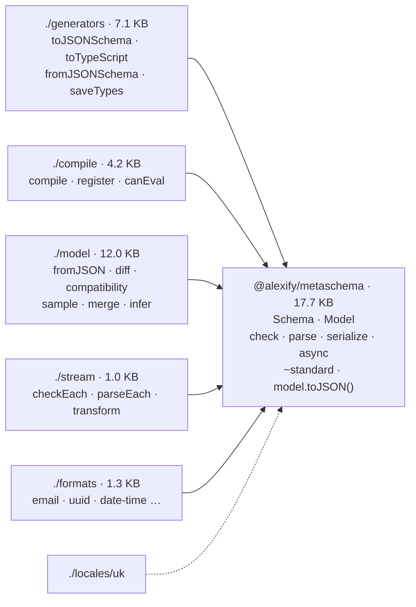
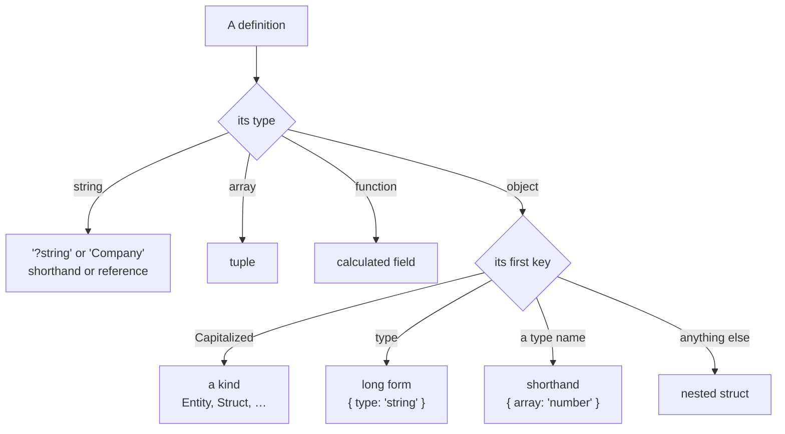
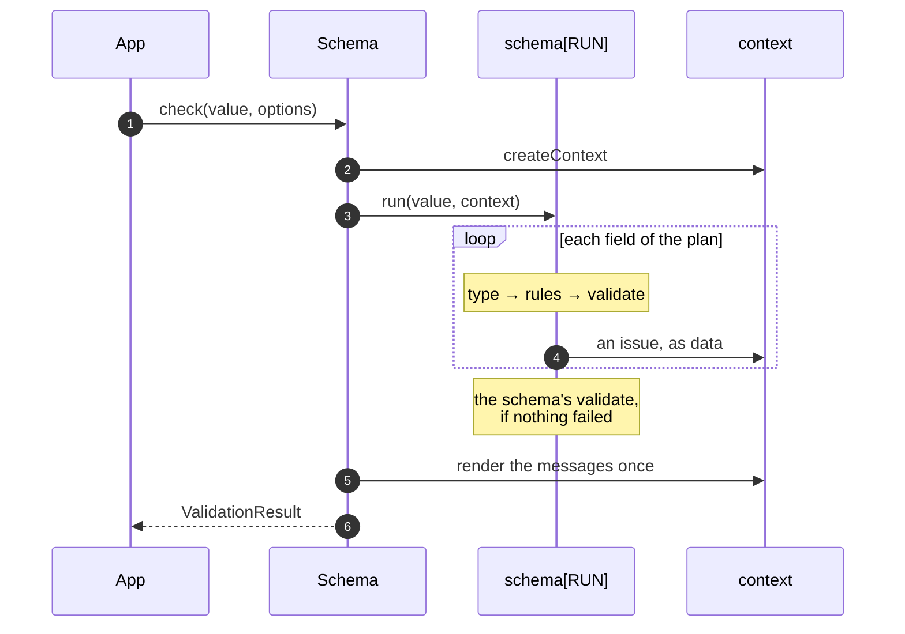
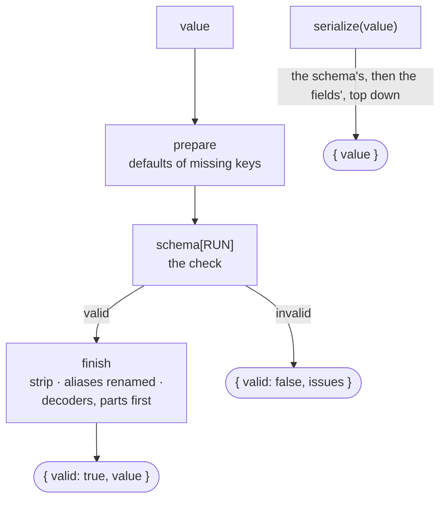
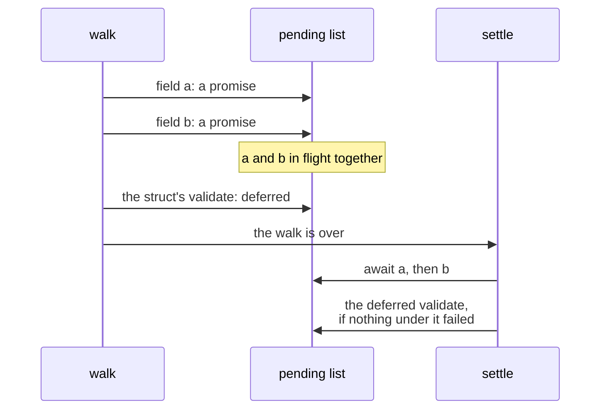
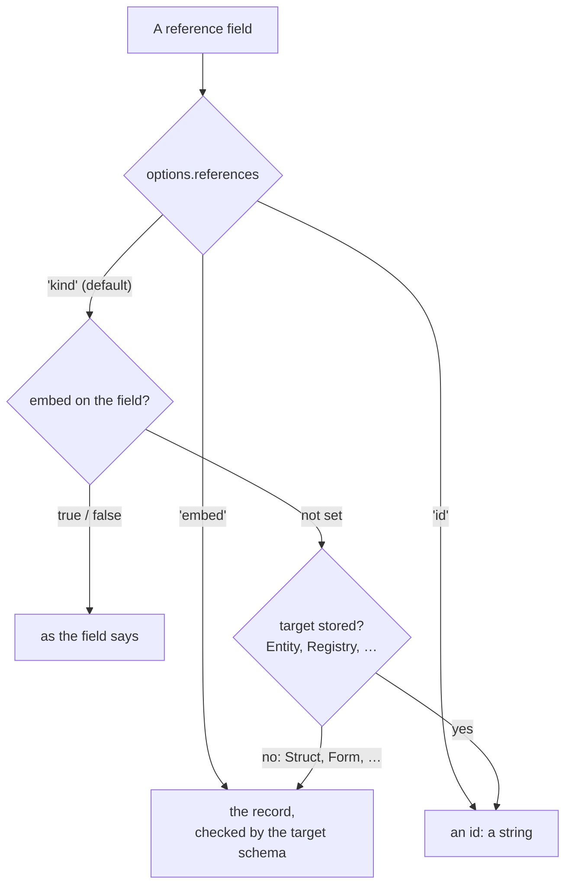
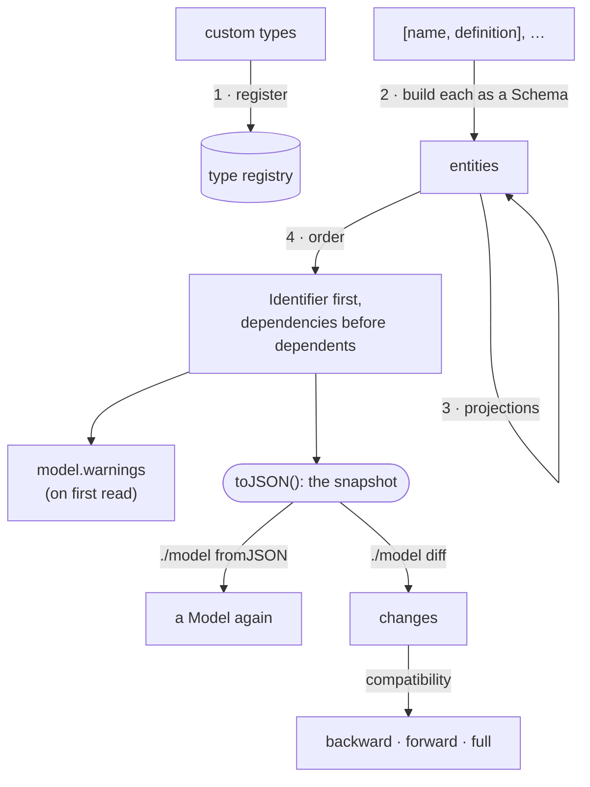
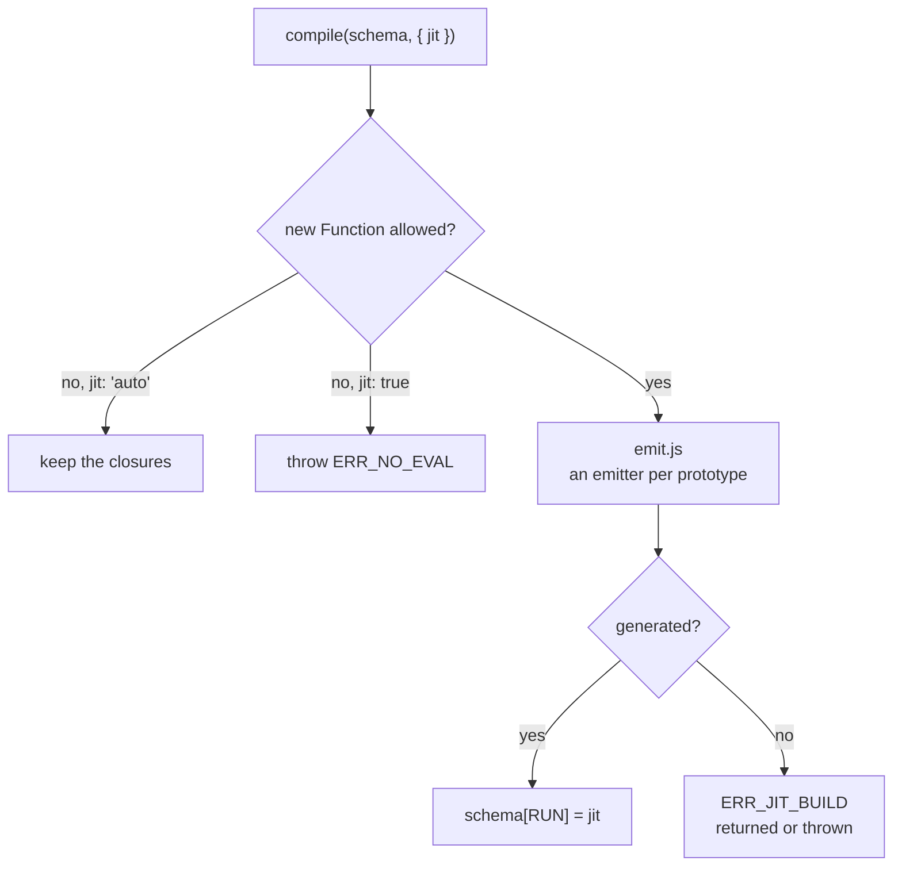

# Architecture

metaschema is a library: a schema is an object in your process, built once from a definition,
and every check is a function call on it. This page follows a definition from the object you
write to the function that checks a value, then a call through `check`, `parse` and the async
methods, and maps each step to the module that does it. The topic pages go deeper; the links say
where.

## The big picture

A definition is parsed once, when the schema is built: every field becomes an instance of a
type, a struct becomes a frozen plan of its fields, and every field compiles its check into a
closure. `schema[RUN]` is the compiled check of the whole schema. `check` and `parse` call it
with a context of their own and turn what it recorded into a result; the [JIT
backend](/guide/compile) replaces it with one generated function and changes nothing else.
Nothing is read from the definition after construction, and nothing global is touched by a
check.

## The packages

The core entry validates; everything that is rendered from a schema, or built on top of it, is
a subpath that imports the core and registers nothing until it is asked to.

The sizes are min+gzip, a subpath measured as what it adds to the core. Each subpath exports
functions and an explicit `register()` that installs them as methods; nothing in the core
requires a subpath, so a bundler drops the ones a program does not import.

| Layer | Modules (under `src/`) | Responsibility |
| --- | --- | --- |
| [Definitions](/guide/schema-syntax) | `preprocessor.js`, `types.js`, `kinds.js`, `metadata.js` | read a definition (the first key decides), the type registry, kinds and their metadata |
| [Types](/guide/types) | `prototypes/*.js`, `rules.js` | one prototype per type with its `compile`; the rules (`length`, `min`/`max`, `pattern`, `format`) |
| Structs | `struct.js` | the null-prototype field dictionary, its plan and its compiled check |
| [Validation](/guide/validation) | `schema.js`, `context.js`, `issues.js`, `result.js`, `locales/` | the context of one call, issues as data, the async drain, messages rendered once |
| [Parse](/guide/parse) | `codec.js` | defaults, strip, decoders and serializers as passes over the built types |
| [Models](/guide/model) | `model.js`, `snapshot.js`, `lint.js` | entities ordered by dependency, the snapshot, the warnings |
| Subpaths | `generators/`, `compile/`, `model/`, `stream/`, `formats/` | each bundled only where it is imported |
| [Platform](/guide/browser) | `runtime/node.js`, `runtime/browser.js` | `writeFile` behind `saveTypes`, the only file that touches a Node builtin |

## From a definition to a check

`new Schema(name, definition)` hands the definition to the `Preprocessor`, which picks a parser
by the type of the source and, for an object, by its **first key**: a capitalized key is a kind,
`type` first is the long form, a type name first is a shorthand, anything else is a nested
struct. A `Schema` or a field that is already built is taken as it is.

A broken definition throws a `SchemaDefinitionError` with a code here, at construction, never
inside `check`. Every field is then built: the type's class copies the rules (a rule the type
does not accept throws `ERR_INVALID_RULE`), and `compile()` returns the field's check as a
closure, wrapped in the rules and the `validate` only when the field has them and in the
`nullable` test last. A struct records a frozen **plan** entry per field (`{ key, type,
required, own, aliases, check }`) and compiles one loop over the plan. See
[Performance](/guide/performance#the-core) for what the loop does and does not do.

## A check

The context is one object per call (`{ issues, count, limit, path, seen, … }`, always one shape);
a container pushes its key on `path` before its children and pops it after them, and a leaf
never touches it. An issue is recorded as data with an empty message; messages are rendered
once, after the walk, through the locale of the call, and the lines with the location only
when `result.errors` is read. `count >= limit` stops every loop at `maxErrors`.

## Parse

`parse` is the same check between two passes of `codec.js` over the built types. A pass returns
after one bit test when the schema carries nothing for it, so a schema without defaults and
decoders parses at about the speed of its check.

Both passes copy a container at the first part that changes and never write to the value given,
so a plain schema returns the very object it was given. See [Parse and serialize](/guide/parse).

## Async

`checkAsync` and `parseAsync` walk the value once, the same way. A validator that returns a
promise is kept with the path it was met at, and a validator met later is deferred only when
it lies over a path that is still pending; everything else runs at once.

The rule that a validator runs only when nothing under it failed holds across promises, and
`maxErrors` stops the settle. See [Async](/guide/parse#async).

## References

A field named with a capitalized name (`'Company'`) is resolved when it is checked, through the
model (`root.findReference`). Whether the value is the target's id or the target's record is
decided per call:

Cycles are tracked only where a record is embedded, and `maxDepth` (128) bounds a deep graph.
See [References](/guide/references).

## The model

The snapshot is the contract other programs read a model through; `@alexify/metaschema/model`
restores it, compares two of them and classifies the change. See [Domain models](/guide/model)
and [Model evolution](/guide/evolution).

## The JIT backend

`compile(schema)` of `@alexify/metaschema/compile` renders the same plan into one function and
installs it as `schema[RUN]`; `register()` does it for every schema built afterwards, through a
slot the core reads once per construction.

Built-in types are inlined; a reference, a custom type and a `validate` function stay calls into
a scope. The generated code records issues through the same constructors as the closures, so the
result of a check is the same object either way. See [The JIT backend](/guide/compile).
