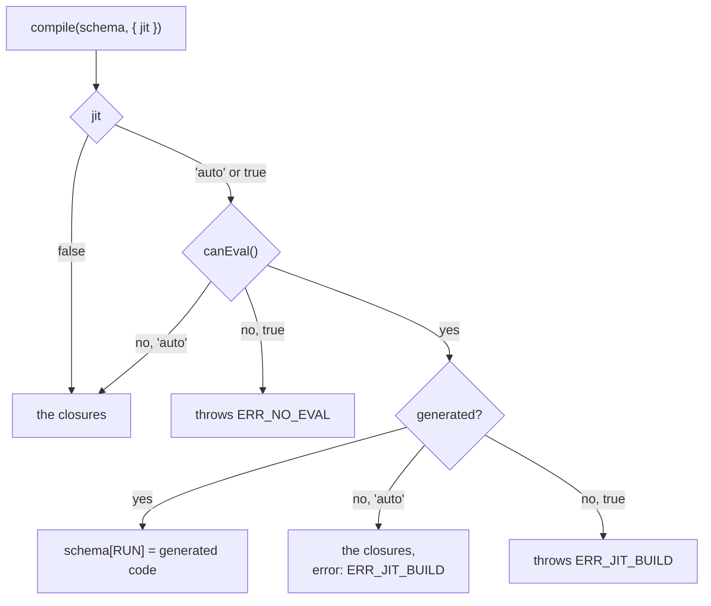

# The JIT backend

Every `check` runs on the closure backend described in [Performance](/guide/performance): one
closure per field, built when the schema is built and called through the struct's plan. The
`@alexify/metaschema/compile` subpath adds a second backend that renders that plan into one
straight-line JavaScript function per schema and builds it with `new Function`. A compiled
schema records exactly the issues the closures record, with the same codes, paths, params, order
and messages; it is only faster: about three times on a flat struct, six on a nested one (the
[numbers](/guide/performance#numbers)).

## compile, register and canEval

```js
const { Schema } = require('@alexify/metaschema');
const { compile, compiled, register, canEval } = require('@alexify/metaschema/compile');

const user = Schema.from({
  name: 'string',
  email: { type: 'string', length: { min: 5, max: 64 } },
  age: '?number',
});

compile(user); // { accelerated: true }
user.check({ name: 'Marcus', email: 'marcus@example.com' }).valid; // true, through generated code
user.check({ name: 7 }).errors; // [ 'Field "name" not of expected type: string', 'Field "email" is required' ]
```

| Export | Meaning |
| --- | --- |
| `compile(target, options?)` | replaces the check of a `Schema`, or of every entity of a `Model`, with the generated one, and returns `{ accelerated, error }`: `accelerated` is `true` when the check runs generated code now and `false` in the fallback, where the closures stay as they were; `error` is what stopped the first check that could not be generated (a `SchemaDefinitionError` with the code `ERR_JIT_BUILD`, the generator's error as its `cause`), absent where the environment allows no code generation at all. `compile(target, { jit: false })` puts the closures a schema was built with back |
| `register(options?)` | compiles every schema built from then on, so an application that wants everything fast calls it once at startup; a later call replaces the options, `register({ jit: false })` stops it; a schema built before the call is not touched (pass it to `compile`). `register({ onFallback(schema, error) })` is told of every schema whose check could not be generated |
| `compiled(target)` | whether a `Schema` (every entity of a `Model`) runs generated code now |
| `canEval()` | whether this environment allows code generation from strings, probed once with `new Function('')` |

Nothing happens on import: a program that never calls `compile` or `register` never runs
`new Function`. `compile` changes the schema in place and returns a report rather than the
schema, so it reads as a statement at the end of the module that defines the schema, and the
object the module exports is the one that got faster.

`register()` installs a hook on the `Schema` class that compiles each new schema as it is built,
the entities of a `Model` included. Building a schema then costs the code generation as well
(tens of microseconds per schema), which is why it is a call at startup and not the default: a
program that builds schemas inside a request handler keeps the closures there, or compiles only
the schemas it keeps.

## The jit option

`compile` and `register` take `{ jit }`:



| `jit` | Where code generation is allowed | Where it is not |
| --- | --- | --- |
| `'auto'` (the default) | the generated check; a check that cannot be generated keeps its closures, with the reason as `error` and in `onFallback` | the closures stay, silently, and `accelerated` is `false` without an `error` |
| `true` | the generated check; a check that cannot be generated throws `ERR_JIT_BUILD`, and nothing of a model is installed | throws `SchemaDefinitionError` with the code `ERR_NO_EVAL`; `register` throws at the call, before any schema is built |
| `false` | the closures; `new Function` is never called, and a compiled schema gets its closures back | the same |

`true` is for the places that want to know: a test suite that must run on the JIT (the
repository's `pnpm run test:jit`), a benchmark. `false` is the explicit switch, for a
configuration flag or an audit that forbids generated code where the platform would allow it.
In the default mode a check that cannot be built, for whatever reason, is the closure backend;
`error` says why, so a bug of the generator never looks like an environment without eval:

```js
const { accelerated, error } = compile(user);
if (!accelerated && error) console.warn(`${user.name}: ${error.message}`, error.cause);
register({ onFallback: (schema, error) => log.warn(`JIT skipped ${schema.name}`, error) });
```

To tell which backend a schema runs on, ask the subpath: `compiled(schema)` is `true` while the
schema (every entity of a model) runs generated code, `false` for a schema built before
`register()` and after `{ jit: false }`. The generated source of a compiled schema is
`schema[Symbol.for('alexify.metaschema.run')].toString()` (before its first check, a schema the
JIT has not compiled holds a stub there that builds the closures on first use: `compiled()` is
the way to ask).

```js
const { compile, compiled } = require('@alexify/metaschema/compile');
compiled(user); // false
compile(user);
compiled(user); // true where the environment allows code generation
```

## Where there is no eval

Code generation from strings is forbidden by a Content Security Policy without `'unsafe-eval'`
(most browser applications that set one), by Cloudflare Workers and other isolates that disable
it, and by `node --disallow-code-generation-from-strings`. `canEval()` is `false` there, the
default mode keeps the closures and nothing else changes: the same `check`, the same issues, the
speed of the closure backend. The repository runs its whole test suite in both modes
(`pnpm run test:jit`, `pnpm run test:nojit`), and both are one suite.

A bundler does not change the answer. The generated code is built at run time from the schema
and never shipped, so there is nothing to tree-shake or to precompile; the subpath requires no
Node.js builtin and resolves to the same file in Node.js and in the browser.

## What the generated code contains

The source of a compiled check holds identifiers, numbers, booleans and JSON strings, and
nothing else from the schema. A regular expression, the test of a [format](/guide/formats), a
`Set` of enum values, a validate function,
a custom type's check, the closure of a reference and the issue constructors reach the function
through a `scope` array and appear in the code by name (`s3.test(x12)`), the way ajv and
schemasafe do it. A key of the schema is a property access (`v.name`) when it is an identifier
and a JSON string literal (`v["a.b"]`) otherwise, with U+2028 and U+2029 escaped; a key or an
enum value that looks like code is a string. `tests/unit/compile.test.js` in the repository
holds a schema of such keys and values against the closures.

What is inlined: structs (the plan, `Object.hasOwn` where the closures ask it, keys named after
members of `Object.prototype`, one `unexpected` issue per struct with the known keys as a
`switch`), every scalar with its rules (`length`, `unicode`, `pattern`, `format`, `min`/`max`), `enum` (a
chain of comparisons, or a `Set` past eight values), `integer`, `date`, `null`, `any`, `json`,
`array`, `set`, `object`, `map`, tuples, unions (a `switch` on the discriminator, or the branches
in order), `nullable` and optional fields, and the limits of a check (`maxErrors`, `unknown`).
What is called: a reference (its target is looked up at check time, as the closures do, and
checked through the target's own check, compiled or not), a custom type's `checkType`, every
`validate` function, and the issue constructors themselves, so an issue of the compiled check is
built by the same code as an issue of the closures.

A valid value never touches the path of the context: the keys a container would push are known
when the code is generated and are pushed only around a statement that records an issue or calls
out, which is where the generated check gains most over the closures on nested values.

The source is strict (`"use strict"` is its first line) and ends with
`//# sourceURL=alexify-metaschema-jit/<schema name>`, so a stack trace through a compiled check
names the schema instead of `<anonymous>`.

## Boundaries

- A compiled schema is the same object with another check: `toJSONSchema`, `toTypeScript`,
  `~standard`, `warnings` and everything else read the definition and do not change.
  [`parse`, `parseAsync`, `checkAsync` and `serialize`](/guide/parse) run over the compiled
  check: the defaults, the decoders and the stripping are passes over the same plan on both
  backends, and the JIT generates nothing for them.
- References resolve at check time, so `attach` and `detach` after `compile` need no second
  call, and an entity reached through a reference runs its own check, compiled or not: compile
  the model, or `register()` before building it, to have every entity accelerated.
- `compile(schema)` twice regenerates the check; the second call changes nothing visible.
  `compile(schema, { jit: false })` restores the closures the schema was built with.
- `register()` is one slot on the `Schema` class: the last call wins, and two libraries that both
  register do not compose. Register once, at startup.
- A custom type keeps its speed: its `checkType` is a call on both backends.
- The invalid path gains less than the valid one (1.6 times against 3 on a flat struct), because
  the issue objects and the rendered messages are the same work on both backends.
