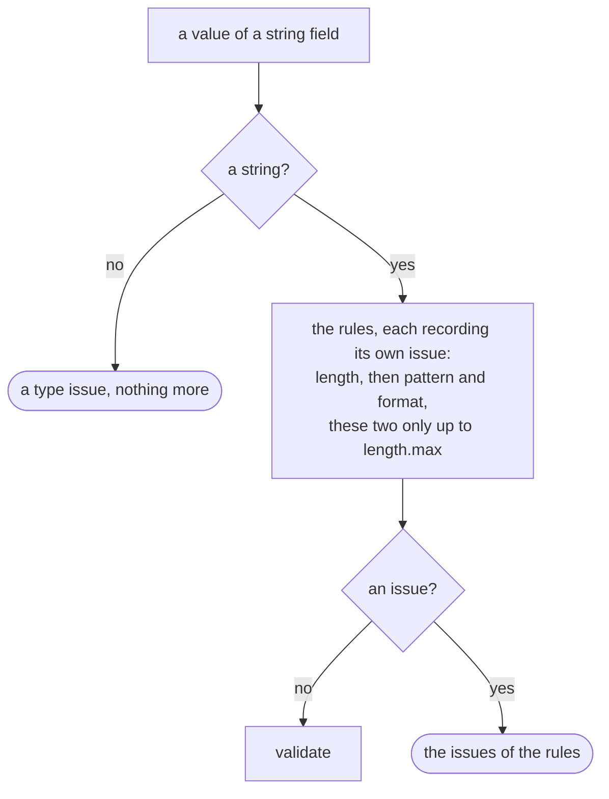

# String formats

`format` is a rule of strings beside [`length` and `pattern`](/guide/types#rules): the name of a
form the string must have, an email, a uuid, a date. The core knows the rule and keeps an empty
table of formats; `register()` of the `@alexify/metaschema/formats` subpath fills it with 35
built-in formats and with your own, so that a program that validates no email carries no email
expression.

```js
const { Schema } = require('@alexify/metaschema');
const { register } = require('@alexify/metaschema/formats');

register();

const signup = Schema.from({
  email: { type: 'string', format: 'email', length: { max: 254 } },
  'site?': { type: 'string', format: 'uri' },
  since: { type: 'string', format: 'date' },
});
signup.check({ email: 'ann@example.com', since: '2026-10-11' }).valid; // true
signup.check({ email: 'ann@', site: 'example.com', since: '2026-02-30' }).issues;
// [
//   { code: 'format', path: ['email'], message: 'is not a valid email', params: { format: 'email' } },
//   { code: 'format', path: ['site'], message: 'is not a valid uri', params: { format: 'uri' } },
//   { code: 'format', path: ['since'], message: 'is not a valid date', params: { format: 'date' } }
// ]
```

A format the table does not know is a definition error when the schema is built, never a check
that passes everything:

```js
Schema.from({ email: { type: 'string', format: 'email' } }); // before register()
// throws SchemaDefinitionError [ERR_INVALID_RULE]: Rule "format" names a format that is not registered: "email" (register() of @alexify/metaschema/formats) in "email"
```

## The rule



`format` applies to `string` fields only (`{ type: 'number', format: 'email' }` is
`ERR_INVALID_RULE`, as any rule on a type that does not accept it). It runs after the type,
`length` and `pattern`, before `validate`, and a failed test is a `format` issue with the name in
`params`; the [locales](/guide/validation#messages-and-locales) render it (`is not a valid
email`, `не є коректним email`). Like a pattern, a format is never run over a string longer
than `length.max` (such a string is reported for its length alone), so a bound keeps a custom
test safe as it keeps a pattern safe; see [Patterns and ReDoS](/guide/validation#patterns-and-redos).
Both backends run the same test: the [JIT](/guide/compile) reaches it through the scope of the
generated code.

The field keeps the name (`schema.fields.email.format` is `'email'`), so a
[snapshot](/guide/model#the-snapshot) writes it, [`diff`](/guide/evolution#diff) compares it and
[`merge`](/guide/schema-syntax#merging-schemas) refuses two different ones. The
[TypeScript type](/guide/typescript) of a formatted field is `string`.

## The built-in formats

`register()` registers 35 formats, in five families. *Inferred* says whether
[`infer`](/guide/infer) reads the format out of data; it tries them in the order of the tables,
the specific forms first, and never one that ordinary words or numbers pass.

**Identifiers**

| Format | Accepts | Inferred | Example |
| --- | --- | --- | --- |
| `uuid` | a UUID of any version, with or without the `urn:uuid:` prefix, in either case | yes | `550e8400-e29b-41d4-a716-446655440000` |
| `ulid` | 26 characters of Crockford's base32, the first at most `7` | yes | `01ARZ3NDEKTSV4RRFFQ69G5FAV` |
| `jwt` | three parts of base64url, the first a JSON object with a string `alg`; the signature is not verified | yes | `eyJhbGciOiJub25lIn0.e30.` |
| `nanoid` | 21 characters of `A-Za-z0-9_-` | no | `V1StGXR8_Z5jdHi6B-myT` |
| `cuid2` | a lowercase letter, then 1 to 31 lowercase letters or digits | no | `tz4a98xxat96iws9zmbrgj3a` |

**Dates and times**

| Format | Accepts | Inferred | Example |
| --- | --- | --- | --- |
| `date-time` | RFC 3339: a `date`, `T` (or `t`, or a space), a `time` | yes | `2026-10-11T12:00:00Z` |
| `iso-date-time` | the same, the offset optional | yes | `2026-10-11T12:00:00` |
| `date` | RFC 3339 `full-date`, the day within its month, leap years included | yes | `2026-10-11` |
| `time` | RFC 3339 `full-time` with its offset (`Z` or `±hh:mm`); a leap second (`:60`) only at 23:59 UTC | yes | `23:59:59.999+02:00` |
| `iso-time` | the same, the offset optional | yes | `12:00:00` |
| `duration` | an ISO 8601 duration of whole units (`P1Y2M3DT4H5M6S`, `P1W`) | yes | `PT15M` |

**Network**

| Format | Accepts | Inferred | Example |
| --- | --- | --- | --- |
| `email` | an address as the fast mode of ajv-formats reads it: a local part of the usual characters, a domain of labels of at most 63 characters | yes | `ann@example.com` |
| `ipv4` | four decimal octets | yes | `192.168.0.1` |
| `cidrv4` | an IPv4 address and a prefix of 0 to 32 bits | yes | `10.0.0.0/8` |
| `ipv6` | the forms of RFC 4291, an embedded IPv4 included | yes | `2001:db8::ff00:42:8329` |
| `cidrv6` | an IPv6 address and a prefix of 0 to 128 bits | yes | `2001:db8::/32` |
| `mac` | six octets of hex separated by `:` or `-`, or three groups of four separated by `.` | yes | `00:1a:2b:3c:4d:5e` |
| `url` | an `http` or `https` address whose host is a hostname, an IPv4 address or an IPv6 address in brackets, with a port of at most 65535 | yes | `https://example.com/path?q=1` |
| `uri` | a scheme, a colon and no whitespace (the form of a URI, not its registry) | yes | `mailto:ann@example.com` |
| `hostname` | labels of letters, digits and hyphens, at most 63 characters each and 253 together | no | `api.example.org` |

**Of JSON Schema**

| Format | Accepts | Inferred | Example |
| --- | --- | --- | --- |
| `uri-reference` | a URI or a relative reference | no | `../up#top` |
| `uri-template` | an RFC 6570 template | no | `/search{?q,page}` |
| `json-pointer` | an RFC 6901 pointer (`''` is the whole document) | no | `/users/0/name` |
| `relative-json-pointer` | a relative JSON pointer | no | `1/name` |
| `regex` | an expression of at most 4096 characters that compiles in unicode mode, as a `pattern` of JSON Schema 2020-12 does | no | `^[a-z]+$` |

**Text and numbers**

| Format | Accepts | Inferred | Example |
| --- | --- | --- | --- |
| `e164` | a phone number in E.164: `+`, then 7 to 15 digits, the first not 0 | yes | `+380501234567` |
| `iban` | an IBAN whose check digits hold (ISO 7064 mod 97-10) | yes | `DE89370400440532013000` |
| `hex-color` | `#` and 3, 4, 6 or 8 hex digits | yes | `#7c5cff` |
| `base64` | base64 with its padding, the length a multiple of 4 (`''` included) | no | `aGVsbG8=` |
| `base64url` | base64url without padding (`''` included) | no | `PDw_Pz8-` |
| `hex` | hex digits, any number of them (`''` included) | no | `deadbeef` |
| `emoji` | one or more emoji, as the engine's Unicode tables have them | no | `👍` |
| `semver` | a semantic version (semver.org), prerelease and build included | no | `2.1.3-beta.1+build.5` |
| `slug` | lowercase letters and digits in groups joined by `-` or `_` | no | `hello-world` |
| `credit-card` | 12 to 19 digits (spaces or dashes between them) whose Luhn sum holds | no | `4111 1111 1111 1111` |

The expressions come from ajv-formats (MIT; the fast mode for `email`, `uuid`, `uri`,
`uri-reference`, `hostname`, `ipv4` and `ipv6`, the full mode for `duration`, `uri-template`
and the JSON pointers), zod (MIT; `ulid`, `nanoid`, `e164`, `hex`, `emoji`, the cidr prefixes,
the forms of a card number and an IBAN), valibot (MIT; `cuid2`, `slug`, `hex-color`, `mac`) and
semver.org, copied into the subpath with their attribution the way the repository copies a
helper instead of adding a dependency. Each is anchored and linear, every repetition bounded or
separated by a character its class excludes, and the repository's tests time each of them on
hostile strings. They are held to those libraries in the tests, value by value, except where
they differ on purpose:

- `date`, `time` and `date-time` check the ranges as well as the form (`2026-02-29` is not a
  date), which ajv-formats' fast mode does not.
- `url` is stricter than what a browser reads: no `_` in a hostname, no shorthand IPv4
  (`http://1.2.3`), no empty port, no backslash, one `@`.
- `jwt` takes any `typ` (RFC 7519 allows `at+jwt`) and wants a string `alg`; nothing is
  verified, and the payload is not read.
- `regex` compiles in unicode mode, where the forms Annex B allows (`{`, `]`, `\a`) are errors,
  and takes at most 4096 characters: compiling an expression costs memory in proportion to its
  text (a property escape such as `\p{L}` expands as it is parsed), and no program writes a
  pattern that long. `length.max` on the field bounds it further.
- `cuid2` is 2 to 32 characters long, the lengths cuid2 makes.
- A card number whose Luhn sum holds and an IBAN whose check digits hold are numbers that may
  exist, not numbers that do.

## Your own formats

`register()` takes the program's formats beside the built-in ones: a `test` over the string, a
few `examples` for [`sample`](/guide/samples) (valid strings), whether [`infer`](/guide/infer)
may read the format out of data (`infer: false` for a form that ordinary words pass), and a
`pattern` for the JSON Schema export (a string that compiles in unicode mode, a shape that never
rejects what `test` accepts). It returns the names of the built-in formats the call replaced
with the program's own (an empty list as a rule), so that a program can log what it overrode:

```js
register({
  phone: { test: (value) => /^\+\d{9,15}$/.test(value), examples: ['+380501234567'] },
  sku: { test: (value) => /^[A-Z]{3}-\d{4}$/.test(value), examples: ['ABC-1234'], pattern: '^[A-Z]{3}-\\d{4}$' },
});
Schema.from({ phone: { type: 'string', format: 'phone', length: { max: 16 } } }).check({ phone: '050' }).errors;
// [ 'Field "phone" is not a valid phone' ]
```

A name is registered once, process-wide, like a [custom type](/guide/custom-types#types-are-registered-globally):
the same `test` again does nothing, another `test` under a name the program registered is
`ERR_FORMAT_REGISTERED` (the schemas built so far hold the first one), and an entry that is not
a format (no `test` function, no example strings, a pattern that does not compile) is
`ERR_INVALID_FORMAT`. Importing the subpath registers nothing; an isolated type registry does
not isolate the formats, which are pure functions. `FORMATS`, the table itself, is exported to
read (`FORMATS.email.examples`), never to write.

**The program's format wins over a built-in of its name.** `register({ ulid: mine })` puts
`mine` in the place of the built-in `ulid` (and in its place in the order `infer` reads), so a
format a program registered before the name was built in keeps working; a later `register()`
does not put the built-in back. A schema built before such a call keeps the test it was built
with: register your formats before you build your schemas.

A custom `test` is the program's code, like a `validate` function: bound the field with
`length.max` if the test backtracks, and keep it synchronous (a promise is not a boolean).

## JSON Schema

[`toJSONSchema`](/guide/json-schema) writes `format` with the name for draft 2020-12, draft-07
and OpenAPI 3.0; the [strict profile](/guide/json-schema#the-strict-profile) drops it with the
other value rules, and a [`$jsonSchema`](/guide/json-schema#the-mongodb-target) has no `format`.
[`fromJSONSchema`](/guide/json-schema#importing-a-document) reads a `format` the table knows back
into the rule and drops any other, as the annotation JSON Schema says a format is unless a
dialect asserts it:

```js
const { toJSONSchema, fromJSONSchema } = require('@alexify/metaschema/generators');
toJSONSchema(signup).properties.email; // { type: 'string', maxLength: 254, format: 'email' }
fromJSONSchema({ type: 'object', properties: { x: { type: 'string', format: 'int32' } }, required: ['x'] }).x; // 'string'
```

The names of the dates, the network forms and the JSON Schema family are those of JSON Schema,
so an exported `format` is read by any validator that knows them. For a format that is not
(`ulid`, `iban`, `semver`, …) the export writes its shape as a `pattern` beside the name, where
the field has no pattern of its own and the profile is not strict: a validator that ignores the
name still checks the shape, and the MongoDB target, which has no `format`, keeps it as its one
assertion. The shape never rejects a value the format accepts (the check digits of an IBAN or a
card are the format's alone). `fromJSONSchema` reads the format back without its shape, and
OpenAPI's `format: 'byte'` as `base64` (the OpenAPI target writes `base64` as `byte`).

Ajv in strict mode refuses a schema with a format it does not know; the table is the one to
give it:

```js
const { FORMATS } = require('@alexify/metaschema/formats');

for (const name in FORMATS) if (!ajv.formats[name]) ajv.addFormat(name, FORMATS[name].test);
```

## Samples and inference

[`sample`](/guide/samples) draws one of the format's `examples` for a formatted field, then
verifies the draw with the field's own check, so a field whose other rules reject every example
(`format: 'email', length: { max: 5 }`) is `ERR_UNSATISFIABLE`.

[`infer`](/guide/infer) writes `{ type: 'string', format }` for a place whose every string
passes a registered format, the first in the order of registration (the order of the tables
above, then the program's own): a column of `2026-10-11T12:00:00` is `iso-date-time`, one of
https addresses `url`, one of https addresses and `mailto:` links `uri`. A format ordinary words
pass (`hostname`, `slug`, `semver`, the JSON pointers, …) is never inferred, and an `enum` of
few recurring values wins over a format. `formats: false` turns the reading off.

```js
const { infer } = require('@alexify/metaschema/model');
infer([{ e: 'ann@example.com', at: '2026-10-11T12:00:00Z' }, { e: 'bob@example.org', at: null }]);
// { Struct: {}, e: { type: 'string', format: 'email' }, at: { type: 'string', format: 'date-time', nullable: true } }
```

## Evolution

In [`diff` and `compatibility`](/guide/evolution#compatibility) a format is read as a pattern:
added, the change is `forward`; removed, `backward`; changed, `none`. `merge` keeps one format
and throws `ERR_MERGE_CONFLICT` for two.

## Boundaries

- **A format is a rule, not a type.** `{ type: 'string', format: 'email' }`, never
  `{ email: ... }`: a type named `email` would make `{ email: 'string', name: 'string' }` read as
  the shorthand of that type (the [first key decides](/guide/schema-syntax#the-first-key-decides)).
- **The tests are forms.** An email that matches is not an address that exists, a uri is not
  fetched, a hostname is not resolved. A `validate` function does what a form cannot.
- **The table is process-wide and read when a schema is built.** A model restored with
  [`fromJSON`](/guide/model#restoring-a-model) needs the formats registered first, or its
  `format` is `ERR_INVALID_RULE` at the field; a format registered after a schema was built
  does not reach that schema.
- **The subpath is 4.0 KB min+gzip on top of the core**, gated at 5 KB; the rule itself is in
  the core. The expressions are written out in one file, so a program that registers the
  formats carries all 35.
- **`emoji` follows the engine.** Its classes are the Unicode properties of the JavaScript
  engine, so an emoji newer than the engine's tables is not one.
