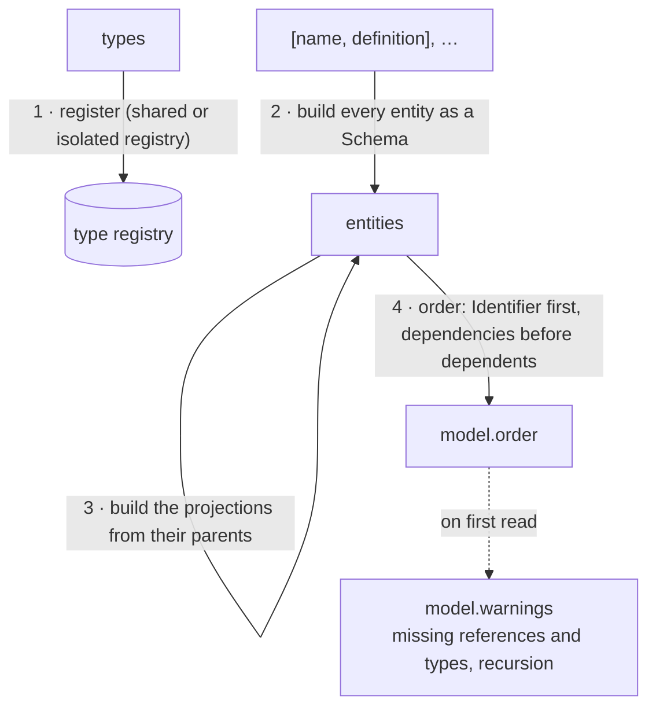

# Domain Models

A `Model` is a set of named schemas that can refer to each other, plus a table of types and
optional database metadata.

```js
const { Model } = require('@alexify/metaschema');

const types = {
  string: { metadata: { pg: 'varchar' } },
  number: { metadata: { pg: 'integer' } },
  boolean: { metadata: { pg: 'boolean' } },
};

const entities = new Map([
  ['Company', { Dictionary: {}, name: { type: 'string', unique: true }, addresses: { many: 'Address' } }],
  ['Address', { Entity: {}, city: 'string', street: 'string', building: '?string' }],
  ['User', { Registry: {}, login: { type: 'string', length: { min: 3, max: 32 } }, company: 'Company', active: 'boolean' }],
]);

const database = { name: 'example', driver: 'pg', version: 1 };

const model = new Model(types, entities, database);
```

`new Model(types, entities, database?, options?)` takes:

- `types`: built-in type annotations and custom types (see [Custom Types](/guide/custom-types)).
- `entities`: any iterable of `[name, definition]` pairs, such as a `Map` or `Object.entries(...)`.
  A definition can also be a `Schema` instance.
- `database`: any metadata you want to carry with the model. metaschema stores it as
  `model.database` and does not read it.
- `options`: `{ registry: 'isolated' }` gives the model its own type registry instead of the
  process-wide one; see [Custom Types](/guide/custom-types#an-isolated-registry).

What the constructor does, in order:



## What a model holds

| Property | Contents |
| --- | --- |
| `model.entities` | `Map` of name → `Schema` |
| `model.types` | the type table, including custom types |
| `model.database` | the `database` argument, or `null` |
| `model.order` | `Set` of entity names, dependencies first |
| `model.warnings` | lint and consistency warnings, `Warning [code]: text` |
| `model.dts`, `model.toTypeScript(options)` | TypeScript interfaces for every entity, after `register()` of the [generators subpath](/guide/json-schema#the-generators-subpath); `toTypeScript(model, options)` without it |
| `model.toJSONSchema(options)` | every entity as a [JSON Schema](/guide/json-schema#models) definition, or the document of one entity; `toJSONSchema(model, options)` of the subpath without `register()` |
| `model.toJSON()` | the model as plain JSON, what `JSON.stringify(model)` writes; see [The snapshot](#the-snapshot) |
| `Model.fromJSON(snapshot, options)`, `Model.diff(prev, next)`, `Model.compatibility(changes)`, `Model.compatibilityOf(change)` | after `register()` of the [model subpath](/guide/evolution#the-model-subpath): a model back from its snapshot, the changes between two versions and their class, the class of one change; the functions of the subpath without it |

```js
model.order; // Set { 'Address', 'Company', 'User' }
model.entities.get('User').check({ login: 'ab', company: 'c1', active: true }).errors;
// [ 'Field "User.login" value is too short' ]
```

## Order

Entities are ordered so that each one comes after the entities it references. An entity named
`Identifier` always comes first. A cycle of any length (`A → B → A`, or `A → B → C → B`) is
reported as `Warning [recursive-reference]: "C" depends on "B" recursively` in `warnings`, naming
the edge where the walk met the cycle again, and the order is still produced. A schema that
references itself is fine.

## Warnings

A definition that can never validate correctly (an unknown type, an `enum` without values, a
`min` above `max`, a `length` on a number) is a broken definition and throws a
[`SchemaDefinitionError`](/api/exports#schemadefinitionerror) when the schema is built. What is
merely not what the author meant is a **warning**: a string of the form `Warning [code]: text`,
collected and never thrown. Every schema lints itself into `schema.warnings` when it is built,
and a model collects the warnings of its entities and adds its own:

| Code | Reported for | Found by |
| --- | --- | --- |
| `unknown-option` | a key of a field definition its type does not read (`{ type: 'string', shorthand: true }`); annotations (`default`, `unique`, `index`, `primary`, `title`, `description`, `examples`, `deprecated`) are known, and a custom type with its own `construct` owns its keys | `schema.warnings` |
| `unbounded-pattern` | a `pattern` without a `length.max`; see [Patterns and ReDoS](/guide/validation#patterns-and-redos) | `schema.warnings` |
| `dead-aliases` | `aliases` on anything but a field of a struct (an element, a branch, a schema of one type), where nothing reads them | `schema.warnings` |
| `dead-coerce` | `coerce` where no conversion can happen: on a reference checked as an id (the record it names is never entered), on `any`, `unknown`, `json` or `null`; see [coercion](/guide/coercion) | `schema.warnings` |
| `missing-index-field` | an index (`index`, `primary`, `unique`) naming a field the schema does not have | `schema.warnings` |
| `missing-reference` | a reference to an entity that is not in the model | `model.warnings` (also `schema.checkConsistency()`) |
| `missing-type` | a type the schema can no longer resolve after a namespace is detached | `schema.checkConsistency()` |
| `recursive-reference` | a cycle in the references between entities | `model.warnings` |

```js
const broken = new Model(types, new Map([
  ['Order', { Entity: {}, buyer: 'Customer', total: { type: 'number', precision: 2 } }],
]));
broken.warnings;
// [
//   'Warning [unknown-option]: option "precision" of "Order.total" is not known to type "number"',
//   'Warning [missing-reference]: "Customer" referenced by "Order" is not found'
// ]
```

The path in an `unknown-option` warning follows the definition: `Order.address.city` for a nested
struct, `Order.tags[]` for the element of a collection, `Order.point[1]` for a tuple element,
`Order.shape|1` for a union branch. Treat warnings as a CI check (`assert.deepStrictEqual(model.warnings, [])`)
to catch a typo in an option name before it is silently ignored.

## The snapshot

`model.toJSON()` is the model as data: the entities in dependency order with their metadata,
fields, indexes and relations, and the types the entities use, as plain JSON with a fixed key
order, so that two builds of one model give the same text. `JSON.stringify(model)` writes it.
It is the contract other programs read the model through: a migration tool reads the entities,
their indexes and their relations and builds the validator of a collection with
[`toJSONSchema(entity, { target: 'mongodb' })`](/guide/json-schema#the-mongodb-target), a
modelling tool imports and exports it, a service introspects its contract through it, and a
committed snapshot is the baseline [`diff`](/guide/evolution#diff) compares a later model with.

```js
const model = new Model(
  { string: { metadata: { pg: 'varchar' } } },
  [
    ['Company', { Dictionary: {}, name: { type: 'string', unique: true } }],
    ['User', { Registry: {}, login: { type: 'string', length: { min: 3, max: 32 } }, company: 'Company', active: { type: 'boolean', default: true }, byLogin: { index: ['login'] } }],
  ],
  { name: 'example', version: 1 },
);

model.toJSON();
// {
//   format: 1,
//   database: { name: 'example', version: 1 },
//   types: { string: { metadata: { pg: 'varchar' } } },
//   entities: {
//     Company: {
//       kind: 'dictionary', scope: 'application', store: 'persistent', allow: 'write',
//       parent: '', unknown: 'reject', custom: {},
//       fields: {
//         name: { type: 'string', required: true, unique: true },
//         companyId: { type: 'string', required: false },
//       },
//       indexes: {},
//       relations: [],
//     },
//     User: {
//       kind: 'registry', scope: 'application', store: 'persistent', allow: 'write',
//       parent: '', unknown: 'reject', custom: {},
//       fields: {
//         login: { type: 'string', required: true, length: { min: 3, max: 32 } },
//         company: { type: 'Company', required: true, one: 'Company' },
//         active: { type: 'boolean', required: true, default: true },
//         userId: { type: 'string', required: false },
//       },
//       indexes: { byLogin: { index: ['login'] } },
//       relations: [{ to: 'Company', type: 'many-to-one' }],
//     },
//   },
// }
```

The format, `format: 1`:

| Key | Contents |
| --- | --- |
| `database` | the `database` argument, as given |
| `root` | only in the snapshot of one schema (below): the name of the schema it is about |
| `types` | the types the entities use, by name, sorted: an alias as `{ js, metadata }` (and the custom type it names, down the chain, which restoring it needs), a type with a check of its own as `{ kind, check: true, metadata }`, a built-in only when it carries metadata (`{ metadata }`) |
| `entities` | every entity in `model.order`: `kind`, `scope`, `store`, `allow`, `parent` (`''` unless a projection), `unknown`, `custom` (the other keys of the kind metadata, as given), then `fields` for a struct or `type` for a schema of one type, `indexes` (the `index`, `primary` and `unique` definitions, as given; a `many` field is a field) and `relations` (`{ to, type }`) |
| a field | its `type` and `required` first, then the other keys of its definition sorted: a nested struct under `schema`, the element of a collection under `value`, the elements of a tuple as a list under `value`, the branches under `union`, the rules as the definition normalised them (`length` as `{ min, max }`, `pattern` as its source, or `{ source, flags }` with flags beyond `u`, `format` by its name), `aliases`, `deprecated` and every annotation |

A function has no JSON form and is written as `{ $function: true }` wherever it stands: a
`validate`, a `parse`, a `serialize`, a `default` factory, a calculated field, and the functions
of the schema itself, which are written among its fields as a nested struct's are. A bigint is
`{ $bigint: '10' }`, a `Date` is `{ $date: '2026-10-11T00:00:00.000Z' }`, bytes (a
`Uint8Array`, a `Buffer`) are `{ $bytes: 'AQL/' }` (base64), a `Map` is `{ $map: [['x', 1]] }`
(its entries) and a `Set` is `{ $set: ['a'] }` (its values), each value inside written the same
way; `fromJSON` reads every tag back into its value, so a restored `default` is a value of its
field again. What has no JSON form at all (a symbol, `NaN`) is left to `JSON.stringify`, which
drops or nulls it.

The repository pins the format with `tests/fixtures/snapshot.json`, the snapshot of its fixture
model.

### The snapshot of one schema

`schema.toSnapshot()` writes the same format for one schema: the schema and every entity it
reaches through its references (and the parent of a projection, which restoring it needs), each
after the ones it references, with the name of the schema as `root` and no `database` metadata. It is
what a program that reads one schema takes (a codec built from it, a form, a client that
encodes positionally), and it needs no model: a schema that names itself (`parent:
'?Category'`) reaches itself.

```js
const model = new Model({}, [
  ['Company', { Dictionary: {}, name: 'string' }],
  ['Category', { Struct: {}, title: 'string', 'parent?': 'Category' }],
  ['Product', { Entity: {}, name: 'string', price: { type: 'number', decimals: 2 }, maker: 'Company', category: 'Category', photo: '?bytes', flags: { flags: ['featured', 'sold'] } }],
]);

model.entities.get('Product').toSnapshot();
// {
//   format: 1,
//   root: 'Product',
//   database: null,
//   types: {},
//   entities: {
//     Company: { kind: 'dictionary', …, fields: { name: …, companyId: … }, … },
//     Category: { kind: 'struct', …, fields: { title: …, parent: { type: 'Category', required: false, one: 'Category' } }, … },
//     Product: {
//       kind: 'entity', …,
//       fields: {
//         name: { type: 'string', required: true },
//         price: { type: 'number', required: true, decimals: 2 },
//         maker: { type: 'Company', required: true, one: 'Company' },
//         category: { type: 'Category', required: true, one: 'Category' },
//         photo: { type: 'bytes', required: false },
//         flags: { type: 'flags', required: true, flags: ['featured', 'sold'] },
//         productId: { type: 'string', required: false },
//       },
//       …
//     },
//   },
// }
```

An anonymous schema is the entity `''` (`root: ''`). A reference no model resolves is left out,
as the snapshot of a model leaves it; two schemas of one name in what a schema reaches (one
derived from an entity keeps its name, and references the entity) cannot be one snapshot, and
are `ERR_UNREPRESENTABLE`. [`fromJSON`](#restoring-a-model) reads it back as a model, whose
entity `snapshot.root` is the schema again (`toSnapshot()` of it writes the same text), and
checks that `root` names one of the entities (`ERR_INVALID_SNAPSHOT` otherwise); `diff` reads it
as any snapshot.

### What format 1 guarantees

The snapshot is a contract, and these hold for every snapshot of format 1; a change of any of
them is a major release, with a format of its own:

- **The fields of a struct come in the order of the definition**, the order `check` visits them
  in: a calculated field in its place, the functions of the schema itself (its `validate`,
  `parse`, `serialize` and `format`) after the fields.
- **The id field of a stored kind (`<entity>Id`, `'?string'`) comes after the fields of the
  definition**, the last of the validated fields, unless the definition has a field of that
  name, which the id field replaces in its place.
- **The entities come in dependency order**: `Identifier` first, then every entity after the
  ones it references, a cycle cut where it closes. A model writes them in `model.order`; the
  snapshot of one schema in the order a walk from the schema meets them, which depends on the
  schema alone and not on the order the model was given its entities in, so a schema restored
  from its snapshot writes the same text again, a cycle included.
- **The keys of a field are its `type` and `required`, then the others sorted**, so the text
  does not depend on how the definition was written; a function is `{ $function: true }`, a
  bigint `{ $bigint }`, a `Date` `{ $date }`.
- **Keys are only added.** A program that reads format 1 ignores a key it does not know: `root`
  is one that 3.4 added, and the rules and types a later release adds (`decimals`, `bytes`,
  `flags` in 3.4) come as new keys of a field and new values of `type`.

In TypeScript a field of a snapshot (`FieldSnapshot`) narrows on its `type`: `{ type: 'enum' }`
has `enum`, `{ type: 'flags' }` has `flags`, a collection its `value`, a reference (whose type is
the capitalized name of its entity) `one` or `many`, a custom type the names `CustomTypes`
declares; `schema.toSnapshot()` is a `SchemaSnapshot`.

### Restoring a model

`fromJSON(snapshot, options)` of the [model subpath](/guide/evolution#the-model-subpath)
(`Model.fromJSON` after its `register()`) builds a model back from a snapshot, with the
structure, the rules and the metadata as they were written. The functions have no body in the
snapshot, so a placeholder stands in for each: a `validate` that passes, a `parse` and a
`serialize` that return the value, a `default` factory and a calculated field that give nothing,
and a custom type whose check accepts everything (and every rule). The restored model validates
the structure, then: a field of the wrong type, a missing key, a rule, an enum, a reference.

```js
const { fromJSON } = require('@alexify/metaschema/model');

const restored = fromJSON(JSON.parse(fs.readFileSync('model.snapshot.json', 'utf8')));
restored.entities.get('User').check({ login: 'ab', company: 'c1', active: true }).errors;
// [ 'Field "User.login" value is too short' ]
JSON.stringify(restored) === JSON.stringify(snapshot); // true: the snapshot of the restored model is the snapshot
```

`options.types` brings the real custom types (entries of the table `Model` takes) over the
snapshot's, where the restored model should validate as the original did; `options.registry`
is `'isolated'` unless it says `'shared'`, so the placeholders of the custom types never reach
the shared registry. A snapshot of another format, or a value that is not one, is
`ERR_INVALID_SNAPSHOT`.

### The snapshot as a trust boundary

A snapshot is input: a file, a row of a registry, the output of another program. `fromJSON`
reads it as such, and `diff` the same.

- **A placeholder accepts.** A `validate` that passes, a `checkType` that accepts every value
  and every rule, a `default` factory that gives `undefined`: the restored model checks types,
  required keys, rules, enums and references, and nothing a function checked. The model lists
  where its placeholders stand in `placeholders`, a non-enumerable property (`JSON.stringify`
  and `toJSON` do not see it, so the snapshot of a restored model is the snapshot): the path
  of every function marker it replaced, `Order.validate`, `Order.total` for a calculated
  field, `Order.address.parse` for the decoder of a nested struct, `Order.when.default`,
  `types.hex.checkType`. The element of a collection, a tuple element and a union branch are
  listed under the field that holds them. A service that restores a model should log the list
  at start-up, and bring the real functions through `options.types` where it can.

  ```js
  const restored = fromJSON(snapshot);
  restored.placeholders; // [ 'types.hex.checkType', 'Order.total', 'Order.validate' ]
  ```

- **A shared registry takes no placeholder type.** With `registry: 'shared'`, a type of the
  snapshot with a check of its own (`check: true`) that `options.types` does not bring is
  `ERR_INVALID_SNAPSHOT`: registered process-wide, the placeholder would stand for the type in
  every schema of the process and refuse the real one later (`ERR_TYPE_REGISTERED`). An entry
  of metadata for a built-in (`string: { metadata: { pg: 'varchar' } }`) is registered as any
  model registers one: that is the contract of the type table.
- **The kind metadata of an entity wins over its `custom` keys.** `unknown`, `scope`, `store`
  and `allow` are read from the entity, never from `custom`, so a snapshot cannot turn a
  closed struct into one that ignores unknown keys through its metadata. An index named like a
  field (`indexes.email` beside the field `email`), which would replace the field, is
  `ERR_INVALID_SNAPSHOT`.
- **The keys of a snapshot are keys.** A field named `__proto__` or `constructor` is a field
  of the restored model, defined on the definition rather than assigned, and `diff` reads own
  keys only, so such a field added is `added`, never compared with `Object.prototype`.
- **The tags are reserved.** Inside a definition value (an `enum` value, a `default`, the
  `metadata` of a type), `{ $function: true }`, `{ $bigint }` and `{ $date }` are read as a
  function, a bigint and a `Date`, since `revive` cannot tell them from a value a program
  wrote that way. A program whose values look like the tags should not round-trip them through
  a snapshot.
- **What a snapshot cannot say is an error, located.** A bigint or a pattern that does not
  read, a date that is not one, a pattern written as an object without a string `source`
  (which would match everything), a field without a type, an entity without a kind, a nesting
  deeper than 128 levels (of nested `value`, `schema` or `union` definitions, or of the objects
  of a value), a chain of more than 128 aliases: `ERR_INVALID_SNAPSHOT`, never a bare
  `SyntaxError` or `TypeError`, with `error.schema` and `error.field` set and the message
  ending with the entity and the path, as a definition error does.

  ```js
  fromJSON({ ...snapshot, entities: { Order: { kind: 'struct', fields: { total: { type: 'bigint', required: true, min: { $bigint: 'abc' } } } } } });
  // throws SchemaDefinitionError [ERR_INVALID_SNAPSHOT]: Cannot convert abc to a BigInt in "Order.total.min"
  ```

  `diff` checks an entity before it reads it (an object with `fields` of objects or a `type`,
  and `relations` as a list of objects), and `compatibility` checks each change it is given (a
  `kind`, an `op`, and `detail.keys` for `changed`; anything else is `ERR_INVALID_TARGET`); a
  definition inside a change that cannot be read is `ERR_INVALID_SNAPSHOT` located at the
  change.

## Loading schemas from files

metaschema does not read files. Keep each schema in a module and assemble the map yourself:

```js
// schemas/Company.js
module.exports = { Dictionary: {}, name: { type: 'string', unique: true } };

// model.js
const { Model } = require('@alexify/metaschema');

const entities = new Map([
  ['Company', require('./schemas/Company.js')],
  ['Address', require('./schemas/Address.js')],
]);

const model = new Model(types, entities);
```
